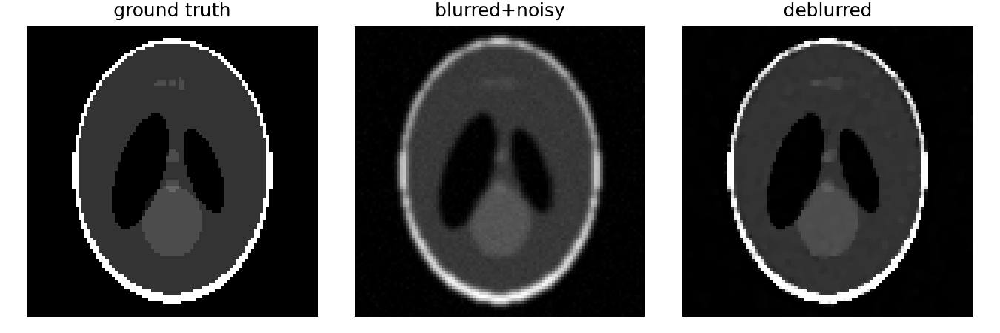

# image-restoration-toolkit

[](LICENSE)
[](https://github.com/abdgafartunde/image-restoration-toolkit/actions/workflows/tests.yml)

A modular Python toolkit collecting **adaptive and quasi-Newton first-order
methods for monotone-inclusion / saddle-point problems**, applied to image
restoration (denoising, deblurring). Companion project to
[eit-reconstruction-toolkit](https://github.com/abdgafartunde/eit-reconstruction-toolkit).

> Status: complete. All three algorithm families, the image operators
> (blur, TV, proximal library), metrics, and utilities are implemented and
> tested (31 tests). `scripts/restoration_demo.py` runs a full
> TV-regularized denoising + deblurring pipeline end-to-end on the
> Shepp-Logan phantom, and `examples/01_restoration_benchmark.ipynb`
> compares all three algorithms side by side (pre-executed, with real
> outputs). See [THEORY.md](THEORY.md) for the mathematical write-up and
> `figures/` for results.

## Sample results



TV-regularized deblurring of the Shepp-Logan phantom (Gaussian blur with
sigma = 1, noise sigma = 0.01) with `var_pdal`: PSNR 19.7 to 29.3 dB, SSIM
0.76 to 0.93. Denoising results, convergence plots, and how to regenerate
them are in [`figures/`](figures/).

## Documentation

- [`examples/00_getting_started.ipynb`](examples/00_getting_started.ipynb): the
  tutorial. Start here.
- [`docs/imrestore-tech-note.pdf`](docs/imrestore-tech-note.pdf): the technical
  note. The algorithms as implemented, verification, results, parameter
  guidance, API reference, and limitations.
- [`THEORY.md`](THEORY.md): derivations and the papers' algorithm boxes.

## Motivation

Image restoration is an inverse problem: recover a clean image `x` from
noisy/blurred measurements `b = Ax + noise`, typically solved as a composite
convex (or monotone-inclusion) optimization problem. This toolkit implements
three complementary lines of work on solving that problem without
hand-tuned step sizes (AdGD and PDAL need no Lipschitz constant; QN-FBS and
VarPDAL need one constant of the smooth part, which sets their metric):

1. **Adaptive step sizes for gradient descent**: no line search, no
   Lipschitz constant, provable convergence.
2. **Inertial quasi-Newton forward-backward splitting**: curvature-aware
   proximal steps for monotone inclusions.
3. **(Variable-metric) primal-dual algorithms with linesearch**: for
   saddle-point formulations (e.g. TV-regularized restoration), extended
   with a quasi-Newton metric.

Each is implemented generically against a shared operator/proximal interface
so they can be benchmarked against each other on the same restoration
problems, rather than living as three disconnected, paper-specific scripts.

## Algorithms

| Module | Method | Paper |
|---|---|---|
| `imrestore.algorithms.adaptive_gd` | Adaptive Gradient Descent (+ accelerated variant) | Malitsky & Mishchenko, *Adaptive Gradient Descent without Descent*, ICML 2020 ([arXiv:1910.09529](https://arxiv.org/abs/1910.09529)) |
| `imrestore.algorithms.quasi_newton_fbs` | Inertial Quasi-Newton Forward-Backward Splitting | Wang, Fadili & Ochs, *Inertial Quasi-Newton Methods for Monotone Inclusion: Efficient Resolvent Calculus and Primal-Dual Methods*, 2022 ([arXiv:2209.14019](https://arxiv.org/abs/2209.14019)) |
| `imrestore.algorithms.var_pdal` | Primal-Dual Algorithm with Linesearch (PDAL) + variable-metric extension (VarPDAL) | Malitsky & Pock, *A First-Order Primal-Dual Algorithm with Linesearch*, SIAM J. Optim. 28(1), 2018 ([arXiv:1608.08883](https://arxiv.org/abs/1608.08883)); Wang, Fadili & Ochs, *A Quasi-Newton Primal-Dual Algorithm with Line Search*, 2024 ([arXiv:2405.06824](https://arxiv.org/abs/2405.06824)) |

All code in this repository is an original reimplementation from the papers
above; see [Acknowledgments](#acknowledgments).

## Project layout

```
imrestore/
├── algorithms/  # adaptive_gd, quasi_newton_fbs, var_pdal
├── operators/   # forward operators (blur), proximal operators, TV
├── metrics/     # PSNR/SSIM, convergence/objective tracking
└── utils/       # image I/O, synthetic phantoms, visualization

examples/    # 00_getting_started.ipynb (tutorial), 01_restoration_benchmark.ipynb
scripts/     # demo/figure-generation scripts, incl. restoration_demo.py
figures/     # generated convergence plots and restoration results
tests/       # unit tests (31, covering algorithms, operators, metrics, utils)
THEORY.md    # mathematical formulation + per-method derivations
```

## Installation

```bash
git clone https://github.com/abdgafartunde/image-restoration-toolkit.git
cd image-restoration-toolkit
pip install -e ".[dev]"
```

Requires Python 3.10 or later. To reproduce the tested environment exactly,
use the lock file: `uv sync --extra dev`. GitHub Actions runs the tests on
Python 3.10 to 3.13, runs every script from outside the repository, and
executes both notebooks.

## Quickstart

**New to imrestore?** Start with the tutorial,
[`examples/00_getting_started.ipynb`](examples/00_getting_started.ipynb): it
deblurs an image step by step with each method and shows how to choose the
regularization weight from the data.

```bash
python scripts/restoration_demo.py
```

runs TV-regularized denoising and deblurring on the Shepp-Logan phantom via
`var_pdal`, printing PSNR/SSIM before and after and saving before/after
image grids + convergence curves to `figures/`. The scripts run from any
working directory; pass `--outdir DIR` to save the figures elsewhere.

Minimal TV denoising example (see `scripts/restoration_demo.py` for the
full deblurring version, which adds a `GaussianBlur` forward operator):

```python
import numpy as np
from imrestore.algorithms.var_pdal import var_pdal
from imrestore.operators.proximal import prox_box
from imrestore.operators.tv import TotalVariation
from imrestore.utils.io import add_gaussian_noise, load_phantom

x_true = load_phantom("shepp-logan", size=96)
noisy = np.clip(add_gaussian_noise(x_true, sigma=0.08, seed=0), 0.0, 1.0)
tv = TotalVariation(weight=0.1)

result = var_pdal(
    K=tv.forward, K_adjoint=tv.adjoint,
    prox_g=lambda v, tau: prox_box(v, 0.0, 1.0),
    prox_f_conj=tv.prox_conj,
    h=lambda x: 0.5 * np.sum((x - noisy) ** 2),
    grad_h=lambda x: x - noisy,
    x1=noisy.copy(), y0=np.zeros((2, *x_true.shape)),
    L_h=1.0, sigma0=0.1, beta=1.0,
)
denoised = result.x
```

## Citation

If you use this toolkit, please cite the original papers for the method(s)
you use (BibTeX below), and optionally this repository (citation metadata in
[`CITATION.cff`](CITATION.cff)):

```bibtex
@inproceedings{malitsky2020adaptive,
  title     = {Adaptive Gradient Descent without Descent},
  author    = {Malitsky, Yura and Mishchenko, Konstantin},
  booktitle = {International Conference on Machine Learning (ICML)},
  year      = {2020}
}

@article{wang2022inertial,
  title   = {Inertial Quasi-Newton Methods for Monotone Inclusion: Efficient Resolvent Calculus and Primal-Dual Methods},
  author  = {Wang, Shida and Fadili, Jalal and Ochs, Peter},
  journal = {arXiv preprint arXiv:2209.14019},
  year    = {2022}
}

@article{malitsky2018firstorder,
  title   = {A First-Order Primal-Dual Algorithm with Linesearch},
  author  = {Malitsky, Yura and Pock, Thomas},
  journal = {SIAM Journal on Optimization},
  volume  = {28},
  number  = {1},
  pages   = {411--432},
  year    = {2018}
}

@article{wang2024quasinewton,
  title   = {A Quasi-Newton Primal-Dual Algorithm with Line Search},
  author  = {Wang, Shida and Fadili, Jalal and Ochs, Peter},
  journal = {arXiv preprint arXiv:2405.06824},
  year    = {2024}
}
```

## Acknowledgments

This toolkit was inspired by exploring public research code for the papers
above, including [ymalitsky/adaptive_GD](https://github.com/ymalitsky/adaptive_GD)
and [wsdxiaohao/quasi_Newton_FBS](https://github.com/wsdxiaohao/quasi_Newton_FBS) /
[wsdxiaohao/VarPDAL](https://github.com/wsdxiaohao/VarPDAL). No code from those
repositories is reused here; all implementations are written independently
from the published papers.

## License

MIT; see [LICENSE](LICENSE).
